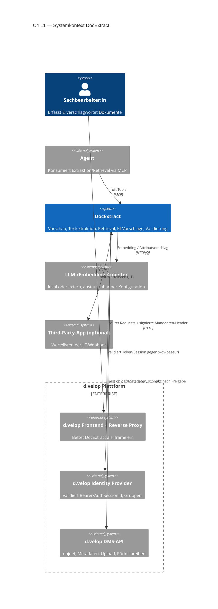
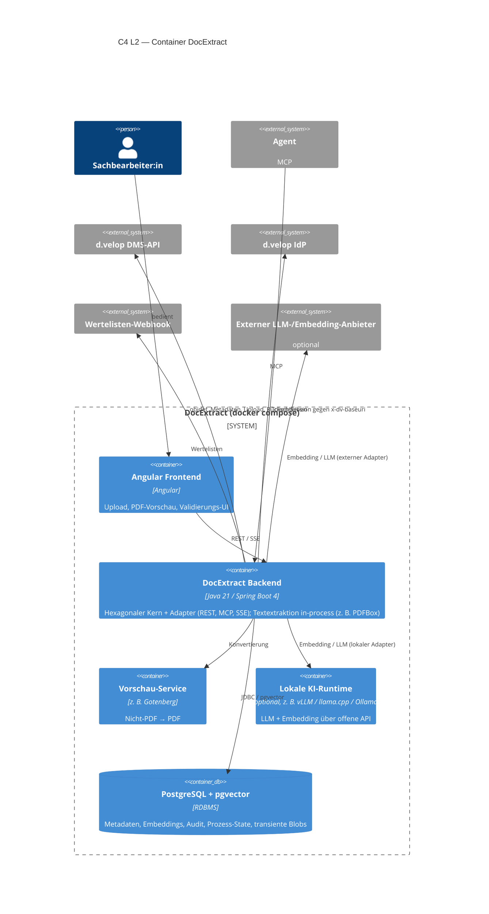
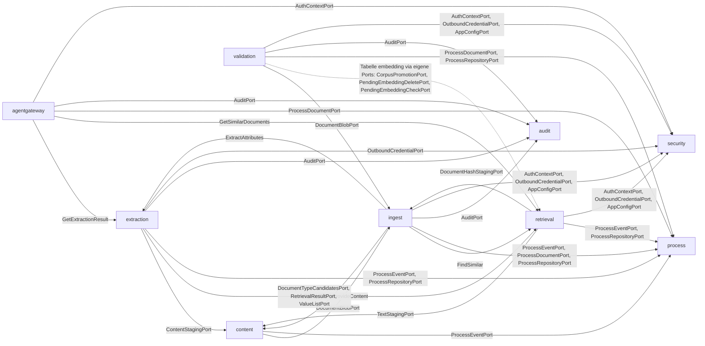
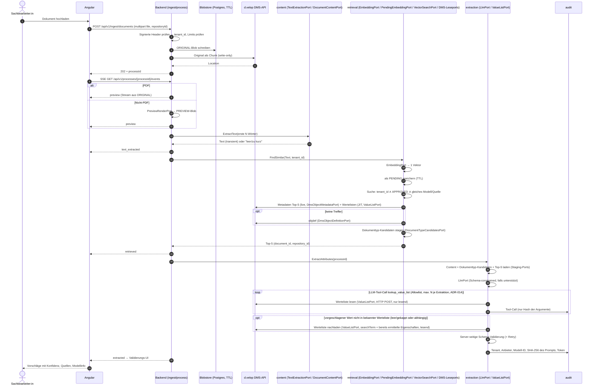
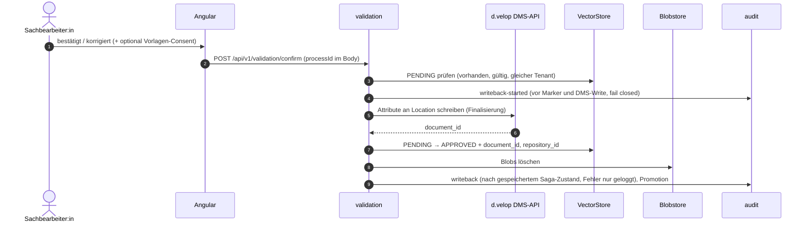
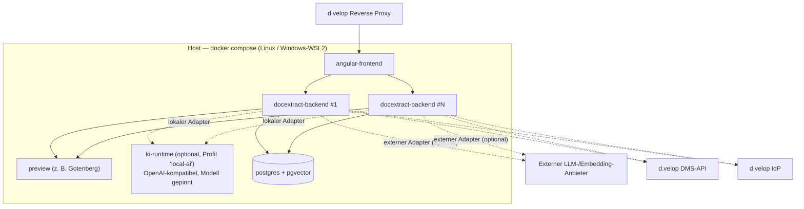
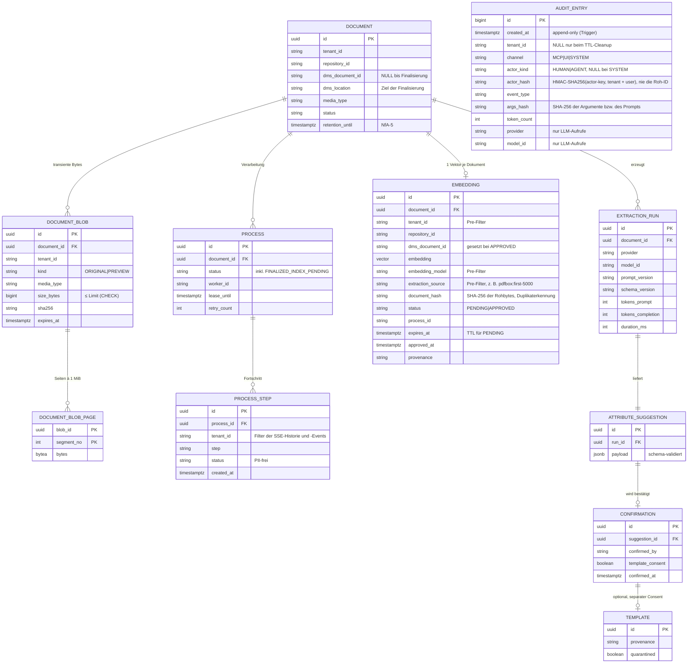

# ARCHITECTURE — DocExtract

**KI-gestützte Dokumenterfassung & -verschlagwortung für d.velop documents**
Architektur-Dokument · Gliederung nach **arc42** · Diagramme in **C4 (Mermaid)**
Bezug: [SPEC.md](SPEC.md) · Blockplanung: [PROJEKTPLAN.md](PROJEKTPLAN.md) · Entscheidungen: § 9 (ADRs)
**Stand:** 09/2026 · **Status:** lebendes Dokument, versioniert pro Block

---

## 0. Traceability zum Bewertungsraster

| Rasterkriterium                                            | Erwartung                           | Abschnitt                   |
| ---------------------------------------------------------- | ----------------------------------- | --------------------------- |
| **Entwurf (4)** Lösungsansatz bildlich + textuell          | C4-Sichten + Prosa                  | § 3, § 5, § 7               |
| **Entwurf (5)** Struktur · Verhalten · Interaktion         | alle drei Perspektiven              | § 5 · § 6 · § 3             |
| **Entwurf (6)** Datenmodell                                | ER-Modell                           | § 8.4                       |
| **Programmierung (7)** Schichten/Module                    | Hexagonal + Modulschnitt            | § 4, § 5.4, § 5.5           |
| **Programmierung (8)** Framework-Konzepte                  | DI, REST, Config, Fehler            | § 5.3, § 8.1                |
| **Validierung (12)** Test-/Sicherheitsstrategie            | Teststufen + Threat-Mitigation      | § 8.6, § 10                 |
| **KI & Architektur (16)** abgesicherte KI-Funktion         | Retrieval + Extraktion + Guardrails | § 6.1, § 8.5, § 8.6, § 10.3 |
| **KI & Architektur (17)** Modulgrenzen, containerlauffähig | Modularer Monolith, Compose         | § 4, § 5, § 7               |
| **KI & Architektur (18)** Reflexion/Veto                   | bewusst nicht delegierte Entscheide | § 9, § 11                   |

---

## 1. Einführung und Ziele

DocExtract liest eingehende Dokumente, schlägt Kategorie und Eigenschaftswerte vor und legt sie **nach menschlicher Freigabe** im DMS (d.velop documents) ab. Fachliche Vision, Stakeholder und Anforderungen stehen in [SPEC.md § 1–5](SPEC.md); dieses Dokument beschreibt, **wie** die Lösung aufgebaut ist.

### 1.1 Wichtigste Qualitätsziele (Details SPEC § 3)

| Prio | Qualitätsziel                                 | Architektonischer Treiber                                                        |
| ---- | --------------------------------------------- | -------------------------------------------------------------------------------- |
| 1    | **Extraktionsgüte** (NfA-1)                   | Retrieval-gestützter Prompt, Schema-Validierung, „unbekannt" statt Halluzination |
| 2    | **Mandanten-Isolation** (NfA-4)               | `tenant_id` als Pre-Filter in jeder Vektor-Query                                 |
| 3    | **Austauschbarkeit** (NfA-8)                  | Produktneutraler Kern, Adapterwahl per Konfiguration, Contract-Tests je Port     |
| 4    | **Zuverlässigkeit** (NfA-3)                   | Timeouts je Stufe/Adapter, definierte Fehlerzustände, Lease-Recovery             |
| 5    | **Effizienz** (NfA-2)                         | Ein Embedding je Dokument, kein Chunking, In-Process-Pipeline                    |
| 6    | **Nachvollziehbarkeit & Kosten** (C-4, NfA-7) | Append-only Audit mit Anbieter, Modell-ID, Token-Verbrauch                       |

### 1.2 Architekturprinzipien

1. **Ports & Adapter überall:** Der Kern kennt nur Schnittstellen und ein neutrales Datenformat. Gotenberg, PDFBox, Tika, Docling, LLM-Runtimes oder pgvector sind **austauschbare Referenzadapter** (C-8).
2. **Konfiguration statt Code:** Adapterwechsel, egal ob lokal oder extern, erfolgt ausschliesslich per Konfiguration.
3. **Mensch entscheidet:** Kein DMS-Write, keine Korpus-Aufnahme, keine Vorlage ohne explizite Freigabe (C-2).
4. **Datenminimierung:** Extrahierter Text wird nie persistiert; Embeddings bleiben bis zur Freigabe in Quarantäne (C-7).

---

## 2. Randbedingungen

| Typ         | Randbedingung                                                                                                                                                                                                                                            | Quelle           |
| ----------- | -------------------------------------------------------------------------------------------------------------------------------------------------------------------------------------------------------------------------------------------------------- | ---------------- |
| Technisch   | Java 21 · Spring Boot 4 · Angular (iframe) · Spring AI · PostgreSQL · Docker Compose (Empfehlung, kein Zwang)                                                                                                                                            | SPEC § 4         |
| Integration | App als **iframe hinter d.velop Approuter/Reverse Proxy**; Mandant und Basis-URI aus den **signierten Headern** `x-dv-tenant-id`/`x-dv-baseuri`/`x-dv-sig-1` (HMAC-SHA256 mit App-Secret, § 8.6); Benutzer per Bearer/`AuthSessionId` beim IdP validiert | SPEC § 4         |
| Betrieb     | `docker compose up` auf Linux und Windows/WSL2; mehrere Backend-Instanzen mit gemeinsamer DB                                                                                                                                                             | SPEC C-6         |
| Fachlich    | Harte, konfigurierbare Limits (Default: 50 MB, Seitenzahl, Timeouts je Stufe)                                                                                                                                                                            | SPEC FR-1, T-4   |
| Sicherheit  | Least Privilege (Agent-Gruppe nur auf MCP), Modell-Pinning, append-only Audit (`audit_entry`)                                                                                                                                                            | SPEC C-3/C-4/C-5 |
| Prozess     | Versioniertes Architektur-Dokument, ADRs für Grundentscheide                                                                                                                                                                                             | Projektarbeit    |

---

## 3. Kontextabgrenzung — C4 Level 1 (Interaktion)

Die Sachbearbeiter:in nutzt DocExtract im **d.velop-Frontend** (iframe); der Approuter/Reverse Proxy routet auf den HTTP-Endpunkt und setzt die signierten Mandanten-Header. Ein **Agent** nutzt denselben Kern über ein **MCP-Tool**; er ist ein technischer d.velop-User in der Agent-Gruppe und darf nur den MCP-Endpunkt aufrufen (§ 8.6). LLM und Embedding werden über offene Schnittstellen angebunden. Sie laufen entweder auf einer **lokalen Runtime** oder bei einem **vom Kunden konfigurierten externen Anbieter**.



### 3.1 Externe Schnittstellen

| Nachbarsystem           | Richtung | Protokoll                                      | Zweck                                                                                                                                                                                     | Hinweis                                  |
| ----------------------- | -------- | ---------------------------------------------- | ----------------------------------------------------------------------------------------------------------------------------------------------------------------------------------------- | ---------------------------------------- |
| d.velop Frontend/Proxy  | in       | HTTP (iframe, REST)                            | UI + API                                                                                                                                                                                  | Signierte Mandanten-Header durchgereicht |
| d.velop Frontend/Proxy  | out      | SSE `GET /api/v1/processes/{processId}/events` | Fortschritt: Event-Name = Schritt (`blob_stored`, `dms_uploaded`, `preview`, `text_extracted`, `retrieved`, `extracted`), `status` `STARTED`/`COMPLETED`/`FAILED`                         | Nur Metadaten, keine PII                 |
| d.velop IdP             | out      | HTTP                                           | Bearer/`AuthSessionId` und Gruppen des Benutzers validieren (gegen `x-dv-baseuri`)                                                                                                        | Basis für NfA-4                          |
| d.velop DMS-API         | in/out   | HTTP                                           | Lesen: `/r/{repositoryId}/objdef`, `/dms/r/{repositoryId}/o2/{document_id}/` (live, kein Cache). Schreiben: Chunk-Upload → `Location`, Finalisierung mit Attributen **nur nach Freigabe** | Chunk-Upload ist write-only (→ ADR-008)  |
| LLM-/Embedding-Anbieter | out      | HTTP(S), z. B. OpenAI-kompatible API           | Embedding, Attributvorschlag                                                                                                                                                              | lokal oder extern per Konfiguration      |
| Third-Party-App         | out      | Webhook (JIT)                                  | Wertelisten                                                                                                                                                                               | Client-only, kein Import                 |
| Agent                   | in       | MCP                                            | Extraktion/Retrieval                                                                                                                                                                      | Agent-Gruppe: nur MCP, nur lesend (T-6)  |

---

## 4. Lösungsstrategie

| Qualitätsziel                 | Lösungsansatz                                                                                                                               | Muster                     |
| ----------------------------- | ------------------------------------------------------------------------------------------------------------------------------------------- | -------------------------- |
| Wartbarkeit, Austauschbarkeit | **Modularer Monolith** mit **Hexagonaler Architektur**; jeder externe Baustein hinter einem Port                                            | Ports & Adapters           |
| Offenheit für beliebige LLMs  | LLM-/Embedding-Port mit **Capability-Modell** (Structured Output, Eingabeform); Referenzprotokoll OpenAI-kompatibel, weitere über Spring AI | Adapter + Capabilities     |
| Mandanten-Isolation           | `tenant_id` als **Pre-Filter** in der Vektor-Query                                                                                          | Security-in-depth          |
| Effizienz, Einfachheit        | **Ein Embedding je Dokument** aus den ersten _N_ Wörtern, kein Chunking                                                                     | Minimal Pipeline           |
| Cluster-Betrieb               | Gemeinsame Datenhaltung in PostgreSQL; laufende Jobs transient instanzgebunden                                                              | Shared-Data, Stateless-App |
| Agent-Konsum                  | REST- und MCP-Adapter teilen dieselben Application-Services                                                                                 | Adapter-Symmetrie          |
| Fortschritts-Feedback         | 202 + `processId`, SSE, Fan-out über Postgres LISTEN/NOTIFY                                                                                 | Event-Push ohne Broker     |
| Korpus-Integrität             | Embeddings als `PENDING` mit TTL, Aktivierung erst nach Freigabe                                                                            | Quarantine-by-Default      |

**Skalierungsmodell:** Die Modultrennung ist **logisch** (Ports, ArchUnit), nicht verteilt. Ein Dokument-Job läuft Ende-zu-Ende auf einer Instanz (In-Process-Aufrufe); verschiedene Dokumente laufen parallel auf verschiedenen Instanzen. Geteilt werden nur Fortschritt, Korpus und transiente Bytes.

---

## 5. Bausteinsicht — C4 Level 2 (Struktur)

### 5.1 Container-Diagramm



### 5.2 Ports & Adapter

Der Kern hängt ausschliesslich von diesen Ports ab. Jeder Adapter muss die **Contract-Test-Suite** seines Ports bestehen (NfA-8, C-8).

| Port                              | Vertrag (Mindestanforderung)                                                                                                                                 | Referenzadapter                             | Mögliche Alternativen                                                         |
| --------------------------------- | ------------------------------------------------------------------------------------------------------------------------------------------------------------ | ------------------------------------------- | ----------------------------------------------------------------------------- |
| **PreviewRenderPort**             | Dokument → PDF-Vorschau; Limits & Timeout einhaltbar                                                                                                         | Gotenberg                                   | JODConverter/LibreOffice headless, Aspose, …                                  |
| **TextExtractionPort** (nur FR-3) | Dokument → Klartext der ersten _N_ Wörter; leerer/zu kurzer Text wird gemeldet                                                                               | Apache PDFBox (in-process)                  | Apache Tika (Library/Server), Docling                                         |
| **DocumentContentPort** (FR-4)    | Dokument → konfigurierte Repräsentation (`FULLTEXT`, `MARKDOWN`, `PAGE_IMAGES`) passend zu den Capabilities des LLM-Adapters                                 | Volltext via PDFBox                         | Markdown via Docling, Seitenbilder via PDFBox-Rendering                       |
| **LlmPort**                       | Prompt + JSON-Schema (+ Repräsentation, + optionale lesende Tools, ADR-014) → Antwort; liefert Anbieter, Modell-ID, Token-Verbrauch; deklariert Capabilities | OpenAI-kompatibler Adapter (lokale Runtime) | beliebige OpenAI-kompatible Runtime oder Anbieter, weitere Spring-AI-Provider |
| **EmbeddingPort**                 | Text → Vektor + Embedding-Modell-ID + Dimension                                                                                                              | OpenAI-kompatibler Adapter (lokale Runtime) | wie LlmPort                                                                   |
| **VectorSearchPort**              | Nur lesend: Ähnlichkeitssuche mit **Pre-Filter** (`tenant_id`, `status`, `embedding_model`, `extraction_source`)                                             | pgvector                                    | Qdrant, OpenSearch (sofern Pre-Filter garantiert)                             |

**Weitere, interne Outbound-Ports** (nicht produktgebunden), bewusst schmal statt eines einzelnen breiten Ports (C-3 Least Privilege):

| Port                         | Modul (Paket)                                 | Zweck                                                                                                                                                |
| ---------------------------- | --------------------------------------------- | ---------------------------------------------------------------------------------------------------------------------------------------------------- |
| `PendingEmbeddingPort`       | retrieval (`port`)                            | `PENDING` stagen; Duplikat-Lookup `APPROVED` per `document_hash`                                                                                     |
| `DmsObjectDefinitionPort`    | retrieval (`port`)                            | `GET .../objdef` (lesend)                                                                                                                            |
| `DmsObjectMetadataPort`      | retrieval (`port`)                            | `GET .../o2/{document_id}/` (lesend)                                                                                                                 |
| `ValueListPort`              | retrieval (`port`), von extraction mitgenutzt | Wertelisten JIT, gefiltert (`searchTerm`) und abhängig von anderen Eigenschaften (lesend)                                                            |
| `CorpusPromotionPort`        | validation (`port`)                           | `PENDING → APPROVED` — einzige Schreibberechtigung auf `status`                                                                                      |
| `PendingEmbeddingDeletePort` | validation (`port`)                           | Ablehnung/TTL: `PENDING` löschen; TTL-Löschung überspringt `FINALIZED_INDEX_PENDING` (ADR-015)                                                       |
| `PendingEmbeddingCheckPort`  | validation (`port`)                           | Vorprüfung vor dem DMS-Write: Tenant und Ablauf des `PENDING`-Embeddings (§ 6.2, ADR-015)                                                            |
| `DmsWritePort`               | validation (`port`)                           | einziger DMS-Schreibpfad (nur nach Freigabe, C-2)                                                                                                    |
| `DmsChunkUploadPort`         | ingest (`port`)                               | Original als Chunk ins DMS (write-only)                                                                                                              |
| `DmsRepositoryPort`          | ingest (`port`)                               | DMS-Repositories lesen (`GET /repo/repositories`)                                                                                                    |
| `DocumentBlobPort`           | ingest (`port`)                               | transiente Roh-/Preview-Bytes (TTL, ADR-008); Löschen je Prozess nach Freigabe/Ablehnung                                                             |
| `AuthContextPort`            | security (`application`)                      | Aufrufer aus dem Security-Kontext: `tenant_id`, Benutzer, Agent-Flag (§ 8.6); ohne Authentifizierung `IllegalStateException`                         |
| `OutboundCredentialPort`     | security (`application`)                      | d.velop-Credential für ausgehende DMS-Aufrufe                                                                                                        |
| `IdentityProviderPort`       | security (`application`)                      | Bearer-Token/`AuthSessionId` beim IdP des Mandanten validieren (Basis-URI aus `x-dv-baseuri`)                                                        |
| `AppConfigPort`              | security (`application`)                      | System-Basis-URI (nur Einzelmandant; im Mehrmandantenbetrieb aus `x-dv-baseuri`)                                                                     |
| `AuditPort`                  | audit (`application`)                         | append-only Audit-Ereignis ohne Roh-PII (C-4), Tabelle `audit_entry`                                                                                 |
| `ProcessEventPort`           | process (`application`)                       | Fortschritt publizieren/abonnieren (`PROCESS_STEP`, LISTEN/NOTIFY, ADR-004); `exists(tenantId, processId)`, `deleteStepsOfIdleProcesses` (Retention) |
| `ProcessDocumentPort`        | process (`application`)                       | DMS-Location und Dateiname je Prozess                                                                                                                |
| `ProcessRepositoryPort`      | process (`application`)                       | Import-Repository je Prozess                                                                                                                         |
| `CorpusMaintenancePort`      | retrieval (`application`)                     | Embeddings eines abgelösten Modells als `STALE` markieren (Re-Indexierung, ADR-012)                                                                  |

**Interne Staging-/Übergabe-Ports** (prozessbezogene Zwischenstände zwischen Pipeline-Stufen, alle im `application`-Paket):

| Port                         | Modul      | Zweck                                                                                                                  |
| ---------------------------- | ---------- | ---------------------------------------------------------------------------------------------------------------------- |
| `TextStagingPort`            | content    | Text der ersten _N_ Wörter, nur in-memory (ADR-006)                                                                    |
| `ContentStagingPort`         | content    | Dokumentrepräsentation für FR-4, nur in-memory (ADR-006)                                                               |
| `DocumentHashStagingPort`    | ingest     | SHA-256 der Upload-Bytes je Prozess                                                                                    |
| `RetrievalResultPort`        | retrieval  | Top-5-Treffer je Prozess                                                                                               |
| `DocumentTypeCandidatesPort` | retrieval  | Dokumenttyp-Kandidaten inkl. objdef/Top-5-Metadaten je Prozess (für FR-4)                                              |
| `ExtractionResultPort`       | extraction | Attributvorschläge je Prozess                                                                                          |
| `FinalizationStatePort`      | validation | Saga-Zustand (`DMS_WRITE_STARTED`/`FINALIZED_INDEX_PENDING`/`COMPLETED`/`INDEX_FAILED`) + DMS-IDs je Prozess (ADR-015) |

**Mandant in den Ports (§ 8.6):** Jeder Outbound-Port, der prozessbezogene Daten liest oder schreibt (`ProcessEventPort`, `ProcessDocumentPort`, `ProcessRepositoryPort`, `RetrievalResultPort`, `DocumentTypeCandidatesPort`, `ExtractionResultPort`, `DocumentBlobPort`, `FinalizationStatePort`, `PendingEmbeddingCheckPort`, `CorpusPromotionPort`, `PendingEmbeddingDeletePort`), nimmt `tenantId` als ersten Parameter, und der Postgres-Adapter filtert danach (`WHERE ... AND tenant_id = ?`). Ausgenommen sind die mandantenübergreifenden Systemjobs (TTL-Cleanup, Promotion-Retry per `findByStatus`) und die in-memory Staging-Ports (nur auf der Instanz des Prozesses, ADR-006).

**Neutrales Datenformat im Kern (Auszug):** `DocumentRef`, `ExtractedText`, `DocumentContent`, `EmbeddingVector(modelId, dim, values)`, `ExtractionRequest`, `ExtractionResponse`, `ExtractedAttribute(propertyId, value, values, confidence, sourceExcerpt)`, `ModelInfo(provider, modelId)`, `LlmTool(name, description, inputSchema, handler)` (ADR-014), `LlmCapabilities(structuredOutput: NATIVE|NONE, inputs: TEXT|IMAGES)`.

### 5.3 Adapterwahl per Konfiguration

Adapter werden über `@ConditionalOnProperty` aktiviert; es ist immer genau ein Adapter je Port geladen. Ein Wechsel erfordert keinen Code im Kern.

```yaml
docextract:
  adapters:
    preview: gotenberg # gotenberg | jodconverter | …
    text-extraction: pdfbox # pdfbox | tika | docling
    document-content: fulltext # fulltext | markdown | page-images
    vector-store: pgvector # wählt den Adapter für VectorSearchPort/PendingEmbeddingPort/CorpusPromotionPort/PendingEmbeddingDeletePort
    llm:
      type: openai-compatible # openai-compatible | <spring-ai-provider>
      base-url: ${LLM_BASE_URL} # lokale Runtime oder externer Endpunkt
      model-id: ${LLM_MODEL_ID} # explizit versioniert, kein "latest" (C-5)
      api-key: ${LLM_API_KEY:}
      api-version: # optional, Microsoft-Foundry/Azure-OpenAI api-version
      timeout: 60s
      max-retries: 1
    embedding:
      type: openai-compatible
      base-url: ${EMBEDDING_BASE_URL}
      model-id: ${EMBEDDING_MODEL_ID}
  text-extraction:
    max-words: 5000 # ≤ Kontextfenster des Embedding-Modells
  limits:
    max-file-size: 50MB
    max-pages: 200
    stage-timeout: 30s
```

**Regeln:** Secrets nur über Umgebungsvariablen. Beim Start wird geprüft, ob `max-words` in das Kontextfenster des Embedding-Modells passt und ob die gewählte `document-content`-Repräsentation zu den Capabilities des LLM-Adapters passt. Ein Wechsel des Embedding-Modells löst eine Re-Indexierung aus (§ 8.5).

### 5.4 Fachmodule

| Modul            | Verantwortung                                                                                                                                                      | Inbound-Port                                                           | Wichtigste Outbound-Ports                                                                                                                                                                                                    |
| ---------------- | ------------------------------------------------------------------------------------------------------------------------------------------------------------------ | ---------------------------------------------------------------------- | ---------------------------------------------------------------------------------------------------------------------------------------------------------------------------------------------------------------------------- |
| **ingest**       | Upload, Limits, Ablage der Roh-Bytes, DMS-Chunk-Upload, Vorschau-Streaming (FR-1); steuert die Pipeline content → retrieval → extraction (`IngestDocumentService`) | `IngestDocument`, `StreamPreview`                                      | `DocumentBlobPort`, `PreviewRenderPort`, `DmsChunkUploadPort`, `DmsRepositoryPort`                                                                                                                                           |
| **content**      | Textextraktion der ersten _N_ Wörter (FR-2) und Dokumentrepräsentation für FR-4; nichts wird persistiert                                                           | `ExtractText`, `ProvideContent`                                        | `TextExtractionPort`, `DocumentContentPort`                                                                                                                                                                                  |
| **retrieval**    | Ein Embedding je Dokument, Staging als `PENDING`, Top-5-Suche mit Pre-Filter (FR-3)                                                                                | `FindSimilar`                                                          | `EmbeddingPort`, `PendingEmbeddingPort`, `VectorSearchPort`, `DmsObjectDefinitionPort`, `DmsObjectMetadataPort`, `ValueListPort`, `AuthContextPort`                                                                          |
| **extraction**   | KI-Attributvorschläge mit objdef, Top-5-Metadaten, Wertelisten; Schema-Validierung, Retry (FR-4)                                                                   | `ExtractAttributes`                                                    | `LlmPort`, `ValueListPort`, `DocumentTypeCandidatesPort` (objdef/Top-5-Metadaten), `RetrievalResultPort` (alle aus retrieval), `ContentStagingPort` (aus content), `ProcessEventPort`, `ProcessRepositoryPort` (aus process) |
| **validation**   | Freigabe, DMS-Rückschreiben, Promotion `PENDING → APPROVED`, separater Vorlagen-Consent (FR-5)                                                                     | `Confirm`, `Reject`, `RetryCorpusPromotion`, `TtlPurger` (TTL-Cleanup) | `DmsWritePort`, `CorpusPromotionPort`, `PendingEmbeddingDeletePort`, `PendingEmbeddingCheckPort`, `FinalizationStatePort`, `DocumentBlobPort` (aus ingest)                                                                   |
| **agentgateway** | MCP-Tool, nutzt dieselben Application-Services (FR-6); nur lesend, Mandantenfilter + `exists` und Audit je Tool-Call (§ 6.3)                                       | `McpTool`                                                              | `GetExtractionResult` (aus extraction), `GetSimilarDocuments` (aus retrieval), `ProcessDocumentPort` (aus process), `AuthContextPort` (aus security), `AuditPort` (aus audit)                                                |
| **process**      | Fortschritt/SSE (`PROCESS_STEP`, LISTEN/NOTIFY), Lease/Heartbeat, Recovery; keine Orchestrierung der Pipeline (liegt in ingest)                                    | `SubscribeProgress`                                                    | `ProcessEventPort`, `ProcessDocumentPort`, `ProcessRepositoryPort`                                                                                                                                                           |
| **audit**        | Append-only Protokoll, Token/Kosten (C-4, NfA-7)                                                                                                                   | —                                                                      | `AuditPort`                                                                                                                                                                                                                  |
| **security**     | Signierte Header → `tenant_id`/Basis-URI, IdP-Validierung, Agent-Gruppe (`SecurityConfig`), Aufrufer mit Actor-Hash                                                | `AuthContextPort`                                                      | —                                                                                                                                                                                                                            |

### 5.5 Paketstruktur

```
ch.adeon.apps.docextract
├─ ingest
│  ├─ domain        # DocumentUpload, Limits, DmsLocation, DmsRepository, ImportInfo
│  ├─ application   # IngestDocumentService (steuert die Pipeline), PreviewStreamService, GetImportInfoService; IngestCommand, IngestedDocument
│  ├─ port          # PreviewRenderPort, DocumentBlobPort, DmsChunkUploadPort, DmsRepositoryPort; BlobRef, PageRange
│  └─ adapter
│     ├─ in.rest    # UploadController (202 + processId), PreviewController (Range), ImportInfoController
│     ├─ out.preview # GotenbergPreviewAdapter (Paketname folgt dem Port, nicht dem Produkt)
│     ├─ out.blob   # PgDocumentBlobAdapter
│     └─ out.dms    # DmsChunkUploadAdapter, DmsRepositoryAdapter (GET /repo/repositories)
├─ content
│  ├─ domain        # Representation
│  ├─ application   # ExtractTextService (erste N Wörter), ContentService; ContentCommand
│  ├─ port          # TextExtractionPort, DocumentContentPort; ExtractedText, DocumentContent
│  └─ adapter.out   # pdfbox | tika | docling
├─ retrieval
│  ├─ domain        # SimilarityQuery, TenantFilter, EmbeddingSpec
│  ├─ application   # FindSimilarService, StagePendingService, ReindexService
│  ├─ port          # EmbeddingPort, VectorSearchPort, PendingEmbeddingPort, DmsObjectDefinitionPort, DmsObjectMetadataPort, ValueListPort; DmsDocumentMetadata, DmsDocumentType, DmsProperty, DmsPropertyDefinition, DmsPropertyDataType, DmsValueList, RetrievalResult
│  └─ adapter.out   # openai-compatible | springai.* | pgvector | dms (DmsObjectDefinitionAdapter, DmsObjectMetadataAdapter, DmsValueListWebhookAdapter)
├─ extraction
│  ├─ domain        # AttributeSchema, Confidence, ModelInfo
│  ├─ application   # ExtractAttributesService (Schema-Validierung, Retry), GetExtractionResultService; ExtractionResult, ExtractedAttribute(sourceExcerpt)
│  ├─ port          # LlmPort (ValueListPort wird aus retrieval.port mitgenutzt)
│  └─ adapter.out   # openai-compatible | springai.*
├─ validation
│  ├─ domain        # Finalization, FinalizationStatus, PendingEmbeddingCheck
│  ├─ application   # ConfirmAndWriteBackService (Freigabe, Saga, Promotion-Retry), RejectSuggestionService, TtlCleanupService (Embeddings + Blobs), ProcessStepRetentionService (`process_step`, § 8.6), FinalizationStatePort; ConfirmationCommand, ConfirmationResult
│  ├─ port          # DmsWritePort, CorpusPromotionPort, PendingEmbeddingDeletePort, PendingEmbeddingCheckPort
│  └─ adapter       # in.rest, in.scheduler (FinalizationRecoveryScheduler), out.dms, out.postgres
├─ agentgateway
│  ├─ application   # McpTool (Inbound-Port), AgentGatewayService (Validierung, Mandantenfilter + exists, Audit); ProcessSuggestions, SimilarDocument, AgentToolException
│  └─ adapter.in.mcp # McpToolAdapter (Tool-Spezifikationen, Spring AI MCP Server), McpServerConfig
├─ process          # Fortschritt (ProcessEvent, ProcessStep, StepStatus), SSE, PgNotify, StaleJobRecovery; ProcessEventPort, ProcessDocumentPort, ProcessRepositoryPort (Import-Repository je Prozess)
├─ audit            # AuditPort, AuditEvent; append-only, ohne Roh-PII
├─ security         # AuthContext, DvelopCredential, AuthContextPort (application); RequestTenant, AgentGroup (domain); DvelopAuthenticationFilter, TenantSignature, SecurityConfig (adapter.in.web); SessionAuthContextAdapter (adapter.out.session)
└─ shared           # Fehler (`shared.error`: Exception-Basisklassen + `ProblemCode`; `shared.adapter.web`: `GlobalExceptionHandler`), Config, Observability, media (MediaType), cleanup (TtlCleanupJob + TtlPurger: jedes Modul löscht nur eigene abgelaufene Zeilen)
```

**Verantwortlichkeitsprinzip:** `domain`, `application` und `port` enthalten **keine Produkt- oder Framework-Typen**. Produktspezifischer Code liegt ausschliesslich in `adapter.*`. Security und Audit werden per DI/Aspekten eingezogen, damit REST und MCP dieselben Guardrails durchlaufen. Erzwungen per ArchUnit (§ 10.1).

### 5.6 Modulschnitt und Verträge

Abgeleitet aus den Java-Abhängigkeiten im Produktivcode (Stand 2026-11-05, `import`-Analyse + ArchUnit). Kanten = Inbound-Port/Service (`application`) oder Outbound-Port (`port`/`application`) des Zielmoduls. Die gestrichelte Kante ist **keine** Code-Abhängigkeit, sondern eine Kopplung über das gemeinsame DB-Schema. `shared` (Querschnitt) ist nicht dargestellt.



`process`, `audit` und `security` haben keine ausgehenden Modulabhängigkeiten. Die Pipeline-Stufen (content → retrieval → extraction) ruft `ingest.application.IngestDocumentService` nacheinander auf; `process` liefert nur Fortschritt/SSE (§ 5.4).

**Nähte:**

- **validation → retrieval (Korpus-Promotion):** _Änderungsgrund:_ Freigaberegeln (FR-5, C-2, Consent) ändern sich unabhängig von Suchverfahren und Embedding-Modell (FR-3, ADR-012). _Kopplung:_ Es gibt keine Java-Abhängigkeit; `validation` besitzt die schmalen Ports `CorpusPromotionPort`, `PendingEmbeddingDeletePort` und `PendingEmbeddingCheckPort`, deren Postgres-Adapter direkt auf die `retrieval`-Tabelle `embedding` (`status`, `tenant_id`, `process_id`, `expires_at`) zugreifen. Die Kopplung liegt damit im Schema, und nur `validation` darf `APPROVED` setzen (C-3). _Resilienz:_ Schlägt die Promotion nach dem DMS-Write fehl, bleibt der Prozess in `FINALIZED_INDEX_PENDING` und wird vom Recovery-Job nachgeholt; bis dahin ist das Embedding `PENDING` und für das Retrieval unsichtbar (ADR-015).
- **extraction → retrieval (Kandidaten, Referenzen, Wertelisten):** _Änderungsgrund:_ Prompt, Schema und LLM (FR-4, C-5) ändern sich unabhängig von Ähnlichkeitssuche und DMS-Metadatenabruf. _Kopplung:_ In-process über `DocumentTypeCandidatesPort` und `RetrievalResultPort` (je `processId` in Postgres gestagt) sowie `ValueListPort`; die Vertragstypen (`DmsDocumentMetadata`, `DmsPropertyDefinition`, `RetrievalResult`, …) liegen in `retrieval.port`. _Resilienz:_ Die Übergabe läuft über gestagte Daten statt über einen Aufruf von `FindSimilar`; findet das Retrieval keine Treffer, liefert es objdef-Kandidaten als Fallback. Scheitert das Retrieval, startet `IngestDocumentService` die Extraktion nicht (`RETRIEVED`/`FAILED`); Wertelisten-Abrufe sind best-effort, ein nicht bestätigter Wert wird „unbekannt" statt geraten.

**Verteilung:** Die Module werden nicht auf getrennte Services verteilt, weil keine Qualitätsanforderung es verlangt (ADR-001); die Grenzen werden per ArchUnit gehalten, damit ein späterer Split möglich bleibt.

**ArchUnit (`HexagonalArchitectureTest`):**

- `adapters_are_not_reachable_from_other_modules` — kein Zugriff auf `adapter` eines anderen Moduls (keine Verletzung).
- `spring_ai_and_mcp_types_stay_in_adapters` — Typen aus `org.springframework.ai..` und `io.modelcontextprotocol..` nur in `adapter` (ADR-009). Grün.
- `other_modules_access_only_application_or_port` — Zugriff auf `domain` eines anderen Moduls ist nicht erlaubt. Grün. Die 23 früher modulübergreifend genutzten Domain-Typen liegen seit 2026-11-05 im `port`- bzw. `application`-Paket des Besitzermoduls, in dessen Signatur sie stehen; `MediaType` liegt in `shared.media`. Liste alt → neu: ENTWICKLUNGSTAGEBUCH.md, Eintrag 2026-11-05 „Domain-Typen verschoben".

Die bis P7 verbliebenen Ausnahmen `ContentException`, `RetrievalException` und `ExtractionException` liegen seit P7 in `shared.error` (Basis `ProcessingFailedException`); damit gibt es keine veröffentlichten Domain-Typen mehr.

---

## 6. Laufzeitsicht (Verhalten & Interaktion)

### 6.1 Happy Path: Upload bis Vorschläge

Der Request wird mit `202 + processId` beantwortet, sobald die Roh-Bytes im Blobstore liegen und das Original als Chunk ins DMS geladen ist. Danach läuft die Pipeline asynchron auf einer Instanz.



**Nachladen von Wertelisten (dynamisch/abhängig):** Das LLM kann während der Extraktion das lesende Tool `lookup_value_list` aufrufen; DocExtract führt es aus (ADR-014, C-3). Danach prüft die Application-Schicht (`ExtractAttributesService`) jeden Vorschlag zusätzlich serverseitig gegen die Werteliste. Bleibt ein Wert ohne Treffer, wird er als „unbekannt" zurückgegeben (E-5).

### 6.2 Freigabe und Korpus-Promotion (C-2, C-7)



**Konsistenz (Saga):** Zuerst DMS-Finalisierung, dann Promotion. Schlägt die Promotion fehl, bleibt der Prozess in `FINALIZED_INDEX_PENDING`; ein idempotenter Retry promotet erneut. Der TTL-Cleanup überspringt diesen Zustand. Entscheid, Preis und Störfälle: ADR-015.
**Ablehnung/Abbruch/TTL-Ablauf:** `PENDING`-Embedding und Blobs werden gelöscht (`POST /api/v1/validation/reject`, `processId` im Body). Nach dem DMS-Write ist keine Ablehnung mehr möglich (`409`).
**Vorlage:** Nur mit separatem, explizitem Consent (FR-5), herkunftsmarkiert.

### 6.3 Agent-Pfad (MCP)

Das MCP-Tool ruft dieselben Services (`FindSimilar`, `ExtractAttributes`) mit der Agent-Gruppe auf. Ein DMS-Write ist auch hier nur nach expliziter menschlicher Freigabe möglich (C-2, T-6). Alle Tool-Calls werden auditiert.

**Umsetzung (Block 3):** Die Tools lesen die Ergebnisse, die die Pipeline (`FindSimilar`, `ExtractAttributes`) je Prozess gestagt hat, über dieselben Lese-Services wie REST (`GetExtractionResult`, `GetSimilarDocuments`). Es gibt **kein** Tool für Upload, Confirm, Reject oder DMS-Write; die Tool-Beschreibung weist darauf hin, durchgesetzt wird es dadurch, dass `McpTool` keine solche Operation anbietet.

| Tool                      | Eingabe (JSON Schema)                                                                                    | Ausgabe (Text-Content, JSON)                                                                  | REST-Pendant                                          |
| ------------------------- | -------------------------------------------------------------------------------------------------------- | --------------------------------------------------------------------------------------------- | ----------------------------------------------------- |
| `get_process_suggestions` | `{ processId }`, `string`, `format: uuid`, Pattern kleingeschriebene UUID, `additionalProperties: false` | `processId`, `documentTypeId`, `attributes[]` (`propertyId`, `value`, `values`, `confidence`) | `GET /api/v1/processes/{processId}/extraction-result` |
| `find_similar_documents`  | wie oben                                                                                                 | `documents[]` (`documentId`, `repositoryId`, `score`), nur `APPROVED`, Top-5                  | `GET /api/v1/processes/{processId}/similar-documents` |

- **Transport:** Spring AI MCP Server (`spring-ai-starter-mcp-server-webmvc`), Streamable HTTP unter `POST/GET /adeon-docextract/api/v1/mcp`, synchron. Ein- und ausgeschaltet über `docextract.adapters.mcp.enabled` (Default `false`); die Property schaltet auch den MCP-Server selbst (`spring.ai.mcp.server.enabled`). Tool-Aufrufe laufen auf dem Request-Thread (`immediateExecution`). Der asynchrone Redispatch der SSE-Antwort ist in `SecurityConfig` nur für `DispatcherType.ASYNC` freigegeben; der initiale Request braucht weiterhin ein gültiges Token.
- **AuthN/Agent-Identität:** Der Agent erhält einen **technischen d.velop-User** und sendet dessen API-Key als `Authorization: Bearer <API-Key>`. Der Endpunkt liegt unter `/api/**` und durchläuft wie REST den `DvelopAuthenticationFilter` (Validierung beim d.velop IdP); es gibt keinen eigenen DocExtract-Token. `tenant_id` und Basis-URI liefert `AuthContextPort` bzw. der `RequestTenant` (§ 8.6). Der Agent-Kanal ist auf den MCP-Endpunkt beschränkt (§ 8.6).
- **Weggelassene Daten:** An den Agenten gehen weder `sourceExcerpt` noch die Eigenschaftswerte der ähnlichen Dokumente (`RetrievalResult.properties`). Von ähnlichen Dokumenten erhält er nur `documentId`, `repositoryId` und `score`. Die Attributvorschläge (`value`/`values`, `confidence`) des eigenen Dokuments gehen an ihn und können Personendaten enthalten. _Begründung:_ Die Eigenschaftswerte wurden mit der Session des Benutzers geladen; gäbe DocExtract sie weiter, sähe der Agent Werte, für die er im DMS keine Rechte hat. Über die `documentId` kann er sie selbst im DMS abfragen, dann gelten seine eigenen Rechte. _Restrisiko:_ Das LLM sieht die Werte der Top-5 als Kontext; ein Vorschlag kann deshalb einen Wert aus einem ähnlichen Dokument übernehmen. Modell-ID und lokal/extern gibt das Tool nicht aus (nicht je Ergebnis gespeichert; Nachweis über das Audit, C-4/NfA-7).
- **Guardrails im Service** (`AgentGatewayService`, nicht im Adapter): Format der `processId`; Mandantenfilter und Existenz (`processId` gehört zum Mandanten des Aufrufers, sonst wie bei unbekannter ID `not_found`, keine Daten; über die Lese-Services und `ProcessEventPort.exists`, § 8.6); ein Audit-Eintrag je Aufruf (`mcp.tool.<name>.<ok|invalid_argument|not_found|error>`, nur SHA-256 der Argumente, C-4). Die Schema-Validierung des MCP-SDK ist abgeschaltet, damit auch ungültige Aufrufe den Service erreichen und auditiert werden; die Prüfung ist dort gleich streng. Umgesetzt mit einem `@Primary`-Customizer in `McpServerConfig`, der den Servlet-Customizer von Spring AI ersetzt (`immediateExecution(true)`, `validateToolInputs(false)`); **bei Spring-AI-Upgrades prüfen**, ob der ersetzte Customizer weitere Einstellungen setzt.
- **Fehler:** `isError: true` mit `{ "code", "type", "title", "detail", "processId"? }` mit denselben `code`/`type`/`title` wie das REST-ProblemDetail (§ 8.1), ohne PII. Unerwartete Fehler: `internal-error` mit festem `detail`.
- **Tests:** `AgentGatewayServiceTest`, `McpToolAdapterTest`, `McpServerWiringTest`, `McpEndpointSecurityTest` (echter HTTP-Stack: ohne Token `401` auf `/api/v1/mcp` und `/api/v1/processes/{id}/events`; schema-ungültiger Tool-Call erreicht den Service und wird auditiert).

### 6.4 Fortschritt im Cluster (ADR-004)

Die SSE-Verbindung kann auf einer beliebigen Instanz landen. Jede Stufe schreibt einen PII-freien Eintrag in `PROCESS_STEP` und sendet `NOTIFY`. Die SSE-haltende Instanz hört per `LISTEN` mit und lädt bei einem Reconnect verpasste Schritte aus `PROCESS_STEP` nach.

### 6.5 Fehlerpfade (NfA-3)

| Fehler                                                   | Verhalten                                                                                              | Endzustand                              |
| -------------------------------------------------------- | ------------------------------------------------------------------------------------------------------ | --------------------------------------- |
| Limit überschritten                                      | Abweisung vor Verarbeitung: Dateigrösse (Limits und Multipart-Limit) `413`, Seitenzahl `422`, gleicher `type` `limit-exceeded` | `413`/`422` ProblemDetail               |
| Leerer/zu kurzer Text (z. B. Scan ohne Textlayer)        | Retrieval übersprungen, Hinweis im UI; FR-4 nur, wenn Repräsentation dies erlaubt (z. B. Seitenbilder) | `failed` oder Vorschlag ohne Referenzen |
| Adapter-Absturz/Timeout (Vorschau, Text, LLM, Embedding) | Timeout je Adapter, begrenzter Retry                                                                   | `failed` + Audit                        |
| Ungültiges LLM-JSON                                      | Retry gemäss Konfiguration, dann Abbruch                                                               | `failed` + Audit                        |
| Externer Anbieter nicht erreichbar                       | wie Timeout; kein automatischer Wechsel auf einen anderen Anbieter                                     | `failed` + Audit                        |
| Instanzausfall                                           | Lease läuft ab → Recovery wiederholt aus ORIGINAL-Blob (solange TTL gültig)                            | definiert beendet oder neu gestartet    |

---

## 7. Verteilungssicht



- **Compose-Profile:** `local-ai` startet eine lokale KI-Runtime. Ohne dieses Profil zeigen die Adapter auf einen externen Endpunkt. Ein Profil `ci` nutzt Mocks und Contract-Stubs.
- **Austausch von Diensten:** Der Vorschau-Container (z. B. Gotenberg) und die KI-Runtime sind reine Referenzbelegungen. Ein anderer Dienst wird eingesetzt, indem man Image und Adapter-Property ändert.
- **Cluster:** N Backend-Instanzen, keine Sticky Sessions, gemeinsame DB. Jobs bleiben transient instanzgebunden (Lease + Heartbeat).
- **Reproduzierbar (C-6):** Images per Digest fixiert, lokale Modelle per Digest und externe Modelle per versionierter Modell-ID gepinnt (C-5).
- **Blobstore:** Pro laufendem Prozess höchstens 2 × Upload-Limit (ORIGINAL + PREVIEW). Das Volumen wird durch TTL und Parallelität begrenzt, eigener Tablespace, `STORAGE EXTERNAL`.

---

## 8. Querschnittliche Konzepte

### 8.1 Framework-Konzepte (Spring Boot 4)

- **DI:** Ports als Interfaces, Adapter als bedingte Beans (`@ConditionalOnProperty`). Security und Audit werden per Aspekt eingezogen.
- **REST:** OpenAPI-spezifiziert, Fehler als ProblemDetail (RFC 9457). Vertrag: [`doc/api/openapi.yaml`](api/openapi.yaml) (OpenAPI 3.1, von springdoc aus den Controller-Annotationen generiert; gemeinsames Fehlerschema `Problem`; `confirm` mit `x-idempotency`, `x-data-classification`, `x-slo`). `OpenApiContractTest` prüft die Datei gegen die generierte Spec (Drift-Check) und validiert sie; neu erzeugen mit `mvn test -Dtest=OpenApiContractTest -Dopenapi.write=true`.
- **Konfiguration:** `application.yml` + Profile (`local`, `local-ai`, `ci`, `cluster`), typisierte `@ConfigurationProperties` mit Validierung beim Start.
- **Fehlerbehandlung:** zentraler `@ControllerAdvice` (`GlobalExceptionHandler`, `shared.adapter.web`, erbt von `ResponseEntityExceptionHandler`); Timeout und definierter Abbruch je Stufe und Adapter. Die Fehlerklassen liegen frameworkfrei in `shared.error` (Basis `DocextractException` mit `ProblemCode`, PII-freiem `detail` und optionaler `processId`); Controller fangen keine Fehler lokal ab.
  - **Fehlerform:** `application/problem+json` mit `type` = `urn:docextract:problem:<code>`, `title`, `status`, `detail` (nie Attributwerte, Dateinamen oder Upstream-Inhalte, C-4) und optional `processId`. Das MCP-Tool nutzt dieselben `code`s (§ 6.3).

    | `code` (`type`-Suffix) | Status | Auslöser |
    | --- | --- | --- |
    | `invalid-request` | 400 | `UploadRejectedException` (leer, Medientyp), fehlende/ungültige Parameter, nicht lesbarer Body, übrige Framework-4xx |
    | `unauthorized` / `forbidden` | 401 / 403 | `SecurityConfig`, `DvelopAuthenticationFilter` |
    | `not-found` | 404 | `ProcessNotFoundException`, `BlobNotFoundException`; unbekannt und fremder Mandant/Nutzer sind nicht unterscheidbar (NfA-4), daher keine eigene Tenant-Mismatch-Klasse |
    | `conflict-state` | 409 | `AlreadyFinalizedException`, `PossiblyAlreadyFinalizedException` |
    | `process-expired` | 410 | `ProcessExpiredException` |
    | `limit-exceeded` | 413 / 422 | `LimitExceededException`: Dateigrösse und Multipart-Limit → 413, Seitenzahl → 422 |
    | `invalid-attributes` | 422 | `InvalidAttributesException` (DMS lehnt Attribute ab; `detail` fest, DMS-Grund nur im Log) |
    | `range-not-satisfiable` | 416 | `RangeNotSatisfiableException`, Header `Content-Range: bytes */<Länge>` |
    | `adapter-unavailable` | 502 | `AdapterUnavailableException` (`DmsRepository-`, `DmsChunkUpload-`, `PreviewRendering-`, `DmsWriteFailed-`, `DmsObjectDefinition-`, `DmsObjectMetadata-`, `ValueListWebhookException`), `detail` fest |
    | `internal-error` | 500 | `ProcessingFailedException` (`ExtractionException`, `RetrievalException`, `ContentException`) und jeder unerwartete Fehler, `detail` fest |

  - **Preview-Range:** Eine einzelne Range `bytes=start[-end]` liefert `206`. Syntaktisch ungültige, mehrfache und Suffix-Ranges (`bytes=-N`) werden ignoriert (`200`, voller Inhalt); beginnt die Range hinter dem Dokumentende → `416`.
  - **Ausnahme SPA:** `NoResourceFoundException` unter `/ui/` wird nicht in ein ProblemDetail gewandelt, sondern per `sendError(404)` an `SpaFallbackErrorController` übergeben.

### 8.2 Sicherheit & Datenschutz

- **AuthN/AuthZ:** Signierte d.velop-Header → `tenant_id` und Basis-URI (§ 8.6) → Filter in jeder prozessbezogenen Port-Abfrage und Pre-Filter im Retrieval (NfA-4). Freigabe durch den Menschen vor jeder irreversiblen Aktion (C-2); Agent-Gruppe ohne Zugriff auf Freigabe-Endpunkte.
- **Least Privilege (C-3):** LLM- und Embedding-Adapter erhalten nur Eingabedaten und haben keinen Zugriff auf DB, Vektor-Store oder DMS. Nur der Validierungspfad setzt `APPROVED`. Das MCP-Tool hat keine schreibende Operation, der Agent ist per Gruppe auf `/api/v1/mcp/**` beschränkt.
- **Prompt Injection (T-1):** Der Dokumentinhalt wird im Prompt klar als _untrusted data_ abgegrenzt. Die Antwort wird immer serverseitig gegen das JSON-Schema validiert. Aus LLM-Ausgaben werden keine schreibenden Tool-Calls abgeleitet; lesende nur per Allowlist (ADR-014).
- **Datenminimierung (NfA-5):** Extrahierter Text und Dokumentrepräsentation leben nur im Job-Kontext. Persistiert werden ausschliesslich Embeddings (mit TTL bis zur Freigabe), Metadaten und Audit-Hashes. Roh-/Preview-Bytes liegen TTL-begrenzt im Blobstore. Die Löschkaskade umfasst Dokument, Blobs und Embeddings; Audit-Einträge bleiben ohne Roh-PII erhalten.

### 8.3 Observability & Audit

- Strukturiertes Logging mit Latenz je Stufe (NfA-2), Metriken (Micrometer/Prometheus), Traces (OpenTelemetry).
- **Audit je LLM-/Tool-Call (C-4):** Tabelle `audit_entry` (§ 8.6): Mandant, Kanal, Actor-Art/-Hash, Anbieter und Modell-ID (`provider`, `model_id`, bei LLM-Aufrufen), **SHA-256** des Prompts bzw. der Argumente (`args_hash`, kein HMAC, kein Klartext), Token (Prompt) und Ereignistyp. Prompt-/Schema-Version, Completion-Token, Konfidenz und Ergebnisstatus werden nicht gespeichert. Datenquelle für NfA-7.
- **Betriebsmetriken:** Anzahl/Alter von `PENDING`-Einträgen und Blobs, Adapter-Fehlerraten je Anbieter.

### 8.4 Datenmodell



**Migrationen:** Flyway. Der pgvector-Index (HNSW) wird mit `tenant_id`, `status` und `embedding_model` als Filterspalten gebaut. Die Vektor-Dimension hängt am Embedding-Modell; ein Modellwechsel erzeugt eine neue Index-Generation und startet die Re-Indexierung. Auf `expires_at` liegt ein Index für den Cleanup.

### 8.5 KI-Integration

Zwei getrennte Modellnutzungen, je über einen eigenen Port und unabhängig konfigurierbar:

- **Retrieval (FR-2/FR-3):** Der TextExtractionPort liefert die ersten _N_ Wörter (Default 5 000). Der EmbeddingPort erzeugt daraus **einen Vektor je Dokument**, der als `PENDING` gespeichert wird. Die Suche liefert die Top-5 mit Pre-Filter auf `tenant_id`, `status = APPROVED` sowie dasselbe `embedding_model` und dieselbe `extraction_source`, damit nur vergleichbare Vektoren verglichen werden. Die Kennzahl ist Precision@3 (NfA-6).
- **Duplikaterkennung:** Der SHA-256-Hash der rohen Upload-Bytes (`document_hash`) wird pro Prozess transient gehalten und bei jedem Embedding-Schritt mitgespeichert. Findet sich für denselben `tenant_id`/`embedding_model`/`extraction_source` bereits ein `APPROVED`-Eintrag mit identischem Hash, wird dessen Vektor wiederverwendet statt den EmbeddingPort erneut aufzurufen — spart Kosten/Latenz bei Mehrfach-Uploads desselben Dokuments (NfA-2/-7).
- **Extraktion (FR-4):** Der LlmPort erhält (a) die konfigurierte Dokumentrepräsentation, (b) Kategorien und Eigenschaften aus objdef, (c) Kategorie und Werte der Top-5 live aus dem DMS sowie (d) Wertelisten. Unterstützt der Adapter Structured Output (`NATIVE`), wird schema-constrained Decoding genutzt. Die serverseitige Validierung erfolgt **immer**. Kann kein zulässiger Wert bestimmt werden, wird „unbekannt" zurückgegeben (E-5).
- **Offenheit für offene LLMs:** Referenzprotokoll ist die verbreitete OpenAI-kompatible API. Damit sind lokale Runtimes mit offenen Modellen und gehostete Anbieter ohne neuen Code nutzbar. Anbieter ohne diese API werden über Spring-AI-Provider oder einen eigenen Adapter angebunden (ADR-009, ADR-011).
- **Modellwechsel (C-5):** Nur per auditierter Konfigurationsänderung und mit Regressionslauf gegen das Eval-Set. Beim Embedding-Modell kommt eine Re-Indexierung hinzu.

### 8.6 Sicherheitskonzept Agent / MCP

Grundsatz: Die Prüfung sitzt im Dienst, nicht in der Tool-Beschreibung und nicht im MCP-Adapter. REST und MCP laufen durch dieselben Application-Services und Ports (§ 4, Adapter-Symmetrie). Die Mandantentrennung hängt **nicht** an einem eigenen Guard, sondern an den Ports: jeder prozessbezogene Port-Aufruf trägt die `tenantId`, die Abfrage filtert danach.

**Mandant (`tenant_id`) und d.velop-Header.** Zwei Betriebsarten, gewählt über `docextract.tenant.app-secret` (Env `DOCEXTRACT_TENANT_APP_SECRET`, Base64-App-Secret aus dem Cloudcenter; die frühere Property `docextract.tenant.header` entfällt):

- **Einzelmandant (Secret leer).** Jeder Request gehört zu `docextract.tenant.default-id` (Default `default-tenant`). `x-dv-*`-Header werden ignoriert, ein Client kann seinen Mandanten nicht wählen. Die System-Basis-URI kommt aus `AppConfigPort` (jstore, sonst `docextract.dvelop.system-base-uri`). Beim Start steht dies als `INFO` im Log.
- **Mehrmandant (Secret gesetzt).** `x-dv-tenant-id`, `x-dv-baseuri` und `x-dv-sig-1` sind Pflicht. Der `DvelopAuthenticationFilter` prüft die Signatur **vor** der IdP-Validierung: HMAC-SHA256 über `baseuri + tenantId`, Schlüssel = Base64-dekodiertes Secret, Vergleich mit `MessageDigest.isEqual` gegen den Base64-dekodierten Header. Fehlt ein Header oder stimmt die Signatur nicht, antwortet er `403` (`tenantId` zusätzlich `[A-Za-z0-9._-]{1,128}`). IdP-Validierung und alle DMS-Aufrufe gehen gegen `x-dv-baseuri`; es gibt keinen Fallback auf `AppConfigPort`, ein `DvelopCredential` ohne Basis-URI ist ein Fehler (`IllegalArgumentException`), ein signierter, aber leerer `x-dv-baseuri` ist `403`. Testvektor der d.velop-Dokumentation: `TenantSignatureTest`.

Der Filter setzt `RequestTenant(id, baseUri)` in den Security-Kontext; `SessionAuthContextAdapter` liefert `AuthContext.tenantId()`, die Basis-URI reist im `DvelopCredential` mit (über `OutboundCredentialPort`). Ohne Authentifizierung wirft `SessionAuthContextAdapter` eine `IllegalStateException`, es gibt keinen Default-Mandanten im Request-Pfad.

**Wer reicht die `tenantId` weiter.** Die Adapter am Rand lösen den Mandanten einmal auf (`ProcessEventsController`, `RetrievalController`, `ExtractionController`, `AgentGatewayService`) und übergeben ihn explizit an `GetSimilarDocuments`, `GetDocumentTypeCandidates`, `GetExtractionResult`, `RetryExtraction`. Die asynchrone Pipeline (`IngestDocumentService` → `FindSimilar`, `StageEmbeddings`, `ExtractAttributes`, `ContentCommand`) bekommt ihn ebenfalls als Parameter, weil virtuelle Threads den Security-Kontext nicht erben; die Basis-URI reist im `DvelopCredential`. `ConfirmAndWriteBackService`, `RejectSuggestionService` und `PreviewStreamService` lesen ihn im Request-Thread aus `AuthContextPort`. Der Promotion-Retry (Scheduler, ohne Request) nimmt ihn aus dem gespeicherten Saga-Zustand (`Finalization.tenantId`).

**Agent und Mensch getrennt (`docextract.agent.group-id`, Env `DOCEXTRACT_AGENT_GROUP_ID`).** Der Agent ist ein technischer d.velop-User in einer d.velop-Gruppe; deren Mitglieder erhalten die Authority `ROLE_GROUP_<id>`. `SecurityConfig` lässt `/api/v1/mcp/**` jedem authentifizierten Aufrufer offen, alle anderen `/api/**` sind für Mitglieder der Agent-Gruppe `403`. Ist MCP aktiv (`docextract.adapters.mcp.enabled`) und die Property leer, bricht der Start ab; `none` heißt bewusst keine Agent-Gruppe (Dev-Profil), dann ist niemand Agent. `AuthContext.agent()` trägt das Flag in die Dienste.

**Audit.** `AuditPort` schreibt insert-only in `audit_entry` (V17, Trigger verweigert `UPDATE`/`DELETE`): `tenant_id`, `channel` (`MCP|UI|SYSTEM`), `actor_kind` (`HUMAN|AGENT`), `actor_hash` (HMAC-SHA256 über Mandant und User-ID mit `docextract.audit.actor-key`, Env `DOCEXTRACT_AUDIT_ACTOR_KEY`; immer Pflicht (sonst Startabbruch), mindestens 32 Zeichen und verschieden vom App-Secret; nur das Profil `dev` hat einen Dev-Schlüssel mit `WARN`), `event_type`, `args_hash`, `token_count`, `provider`, `model_id` (beide nur bei LLM-Aufrufen). Geschrieben werden MCP-Tool-Calls (auch Fehlerfälle, `mcp.tool.<name>.<ergebnis>`), `ingest.completed`, `validation.writeback-started` (vor Marker und DMS-Write, fail closed), `validation.writeback` (nach dem DMS-Write und dem gespeicherten Saga-Zustand), `validation.writeback-rejected`, `validation.reject` (Kanal `UI`) sowie Systemereignisse mit Mandant (`validation.promotion*`, LLM-Aufrufe `extraction.classify`/`extraction.suggest-attributes` mit Anbieter und Modell, Tool-Aufrufe `extraction.tool.lookup_value_list`). `tenant_id` ist nur beim TTL-Cleanup (`validation.ttl-cleanup`) `NULL`; `actor_kind`/`actor_hash` sind bei allen Systemereignissen `NULL`. Ein Audit-Fehler lässt die Anfrage scheitern (fail closed), außer nach dem DMS-Write: dort steht der Saga-Zustand schon, ein Fehler bei `validation.writeback` (und `validation.writeback-rejected`) wird nur als `ERROR` geloggt und die Antwort bleibt `200`; so führt ein Audit-Ausfall nie zu einem zweiten, abgelehnten DMS-Write.

| #   | Regel                                                                                                                                                                                                                                                                                                                                                                                                                                                                   | Durchgesetzt in                                                                                                                                                                                                                                                                                                                                                                        | Test                                                                                                                                                                                 |
| --- | ----------------------------------------------------------------------------------------------------------------------------------------------------------------------------------------------------------------------------------------------------------------------------------------------------------------------------------------------------------------------------------------------------------------------------------------------------------------------- | -------------------------------------------------------------------------------------------------------------------------------------------------------------------------------------------------------------------------------------------------------------------------------------------------------------------------------------------------------------------------------------- | ------------------------------------------------------------------------------------------------------------------------------------------------------------------------------------ |
| 1   | **Autorisierung.** Der Agent authentisiert sich mit dem API-Key eines technischen d.velop-Users ohne DMS-Rechte als `Authorization: Bearer` (§ 6.3); ohne gültiges Token `401`. Mitglieder der Agent-Gruppe dürfen nur `/api/v1/mcp/**`; confirm, reject, extraction-result, SSE u. a. sind für sie `403`. Der Mandant kommt wie oben aus dem Einzelmandant-Default oder den signierten Headern.                                                                        | `DvelopAuthenticationFilter`, `SecurityConfig`, `SessionAuthContextAdapter`                                                                                                                                                                                                                                                                                                            | `McpEndpointSecurityTest` (401, Agent 403 auf REST, Agent/Mensch auf MCP mit Audit), `TenantResolutionTest`, `TenantSignatureTest`                                                   |
| 2   | **Eingabeprüfung.** Tool-Argumente: genau `{ processId }`, kleingeschriebene UUID. Existenz und Ownership ohne Guard: die Lese-Services fragen den mandantengefilterten Port; nur bei leerem Ergebnis prüft `ProcessEventPort.exists(tenantId, processId)` (Zeile in `process_step`), sonst `ProcessNotFoundException` → `404` bzw. `not_found` (MCP). Gilt für similar-documents, document-type-candidates, extraction-result, retry, reject und SSE (vor dem Stream). | `AgentGatewayService` (Format), `GetSimilarDocumentsService`, `GetDocumentTypeCandidatesService`, `GetExtractionResultService`, `ExtractAttributesService.retry`, `RejectSuggestionService`, `ProcessEventsController`; Port-Filter in `PgProcessDocumentAdapter`, `PgRetrievalResultAdapter`, `PgExtractionResultAdapter`, `PgDocumentTypeCandidatesAdapter`, `PgProcessEventAdapter` | `AgentGatewayServiceTest`, `McpToolAdapterTest`, `TenantScopedEndpointsTest` (je Endpunkt), `PgTenantFilterAdapterTest`, `PgProcessEventAdapterTest`, `PgRetrievalResultAdapterTest` |
| 3   | **Schreibende Aktionen nur auf dem eigenen Mandanten.** Confirm, Reject, Promotion und Blob-Löschung wirken nur auf Zeilen des Aufrufer-Mandanten.                                                                                                                                                                                                                                                                                                                      | `ConfirmAndWriteBackService`, `RejectSuggestionService`, `PgCorpusPromotionAdapter`, `PgPendingEmbeddingDeleteAdapter`, `PgFinalizationStateAdapter`, `PgDocumentBlobAdapter`                                                                                                                                                                                                          | `ConfirmAndWriteBackServiceTest`, `RejectSuggestionServiceTest`, `PgPendingEmbeddingDeleteAdapterTest`, `PgDocumentBlobAdapterTest`                                                  |

**Antwort bei unbekanntem oder fremdem Prozess.** Beides ist für den Aufrufer dasselbe: `404` (RFC 9457) bzw. `not_found` im MCP-Tool, ohne Existenzhinweis (NfA-4). Ein eigener Prozess ohne Ergebnis liefert `200` mit leerer Liste bzw. leerem Ergebnis. `process_step` ist die Existenzquelle: `DMS_UPLOADED` wird synchron im Upload-Request vor dem `202` veröffentlicht und ist damit sicher committet; `BLOB_STORED` kommt aus der asynchronen Kette und ist vor dem `202` nicht garantiert (`IngestDocumentServiceTest`). Der `ProcessStepRetentionService` (`TtlPurger`) löscht alle Schritte eines Prozesses, dessen neuester Schritt älter als `docextract.process.step-retention` (Default `PT48H`) ist; Prozesse in `FINALIZED_INDEX_PENDING` überspringt er über die `process_id` allein (nicht über Mandant und Prozess; die IDs sind UUIDs). Beim Start muss die Retention ≥ jede Ergebnis-/Blob-/PENDING-TTL und ≥ `promotion-retry-limit` sein, sonst Abbruch.

**Primärschlüssel.** `extraction_result`, `document_type_candidate` und `process_finalization` haben `(tenant_id, process_id)` als Primärschlüssel (V16); dieselbe `process_id` zweier Mandanten kollidiert nicht.

**Offen (nicht umgesetzt):**

- **Minimale Rechte (Scopes).** Es gibt keine Scope-Liste (`suggestions:read`, `similar:read`). Der Agent ist durch die Gruppe auf `/api/v1/mcp/**` beschränkt, das MCP-Tool bietet nur lesende Operationen. Der Agent-User sollte trotzdem keine DMS-Rechte haben.
- **Vorlagen-Consent.** Existiert noch nicht; die Sperre für den Agent-Kanal gilt bereits für alle Nicht-MCP-Endpunkte.
- **Audit-Schlüssel.** `docextract.audit.actor-key` wird nicht rotiert; ein Wechsel ändert alle künftigen `actor_hash` (alte Einträge bleiben, sind aber nicht mehr zuordenbar).

---

## 9. Architekturentscheidungen (ADRs)

ADR-001 bis ADR-003 wurden **bewusst nicht an die KI delegiert** (Krit. 18). Archiviert: ADR-005 (abgelöst durch ADR-008), ADR-007 (docling-Chunking, abgelöst durch ADR-012), ADR-010 (anbieterspezifischer Opt-in, aufgegangen in ADR-011).

### ADR-001 — Modularer Monolith statt Microservices

- **Status:** akzeptiert
- **Entscheidung:** Ein deploybarer Monolith mit hexagonalen Fachmodulen; Cluster über gemeinsame Datenhaltung.
- **Begründung:** Keine NfA rechtfertigt Verteilungskosten. In-Process-Aufrufe halten die Latenz tief (NfA-2).
- **Konsequenz:** Modulgrenzen werden per ArchUnit hart gehalten, damit ein späterer Split möglich bleibt.

### ADR-002 — Mandanten-Pre-Filter im Retrieval

- **Status:** akzeptiert
- **Entscheidung:** `tenant_id` aus dem signierten d.velop-Header (bzw. dem Einzelmandant-Default) ist Prädikat der Vektor-Query, kein Post-Filter.
- **Begründung:** Garantiert 0 Fremdtreffer und ist testbar (NfA-4, T-3).
- **Konsequenz:** Jeder VectorStore-Adapter muss den Pre-Filter im Contract-Test nachweisen.

### ADR-003 — Human-in-the-Loop mit hartem Consent-Gate (auch MCP)

- **Status:** akzeptiert (präzisiert durch ADR-014: gilt für schreibende Tool-Calls)
- **Entscheidung:** Keine LLM-Ausgabe löst selbsttätig einen Write oder Tool-Call aus. DMS-Write, Promotion und Vorlagen-Aufnahme erfolgen nur nach expliziter Freigabe, in UI und MCP gleich.
- **Konsequenz:** `DmsWritePort` ist der einzige Schreibpfad. Der initiale Chunk-Upload ohne Attribute gilt nicht als irreversibler Write.

### ADR-004 — Asynchrone Pipeline mit SSE über Postgres LISTEN/NOTIFY

- **Status:** akzeptiert
- **Entscheidung:** 202 + `processId`, SSE je Prozess, Fan-out via LISTEN/NOTIFY, durable `PROCESS_STEP` für Catch-up.
- **Begründung:** Kein zusätzlicher Broker nötig; Postgres ist bereits gemeinsame Basis.
- **Konsequenz:** Payload nur `processId`/`step`; Heartbeat gegen Proxy-Timeouts.

### ADR-006 — Text flüchtig, Embeddings in Quarantäne

- **Status:** akzeptiert (aktualisiert: Chunks entfallen)
- **Entscheidung:** Extrahierter Text und Dokumentrepräsentation bleiben im Job-Kontext. Das Embedding wird als `PENDING` mit TTL gespeichert und nach Freigabe ohne Neuberechnung promotet, sonst gelöscht.
- **Begründung:** Keine doppelte Vektorisierung, kein Rohtext at-rest, ungeprüfte Dokumente beeinflussen den Korpus nicht (T-2).
- **Konsequenz:** TTL-Cleanup, Schutz von `FINALIZED_INDEX_PENDING`, Tests gegen `PENDING`-Treffer.

### ADR-008 — Transienter Postgres-Blobstore (gechunktes BYTEA)

- **Status:** akzeptiert
- **Kontext:** Der DMS-Chunk-Upload ist write-only; ein gemeinsamer Object Store ist nicht vorhanden.
- **Entscheidung:** `DOCUMENT_BLOB` + `DOCUMENT_BLOB_PAGE` (1-MiB-Seiten) als cluster-sichtbare Quelle für Job und Range-fähige Vorschau.
- **Begründung:** Range-Zugriff ohne Heap-Materialisierung; derselbe TTL-Cleanup wie für Embeddings. Large Objects hätten eine zweite Aufräumsemantik gebracht.
- **Offene Grenze:** Bei deutlich höheren Limits oder hoher Parallelität wird ein Object Store hinter dem `DocumentBlobPort` eingesetzt.

### ADR-009 — Spring AI als technische KI-Integrationsschicht

- **Status:** akzeptiert (aktualisiert: anbieterneutral)
- **Entscheidung:** Spring AI wird **innerhalb der Adapter** für Chat, Embedding, Structured Output und MCP genutzt. Spring-AI-Typen verlassen die Adapter nie.
- **Begründung:** Breite Provider-Abdeckung ohne eigene Integrationen; passt zum Spring-Stack.
- **Abgrenzung:** Retrieval-Filter, Quarantäne, Consent, Audit und Prompt-/Schema-Versionierung bleiben in DocExtract. Der generische Spring-AI-`VectorStore` wird nicht verwendet, wenn er die Pre-Filter verdecken würde.
- **Ausnahme:** Reicht Spring AI für eine Funktion nicht aus, darf ein Adapter die Anbieter-API direkt nutzen, gekapselt hinter demselben Port.

### ADR-011 — Offener, produktneutraler Adapter-Ansatz für alle externen Bausteine

- **Status:** akzeptiert
- **Kontext:** SPEC C-8/NfA-8: Vorschau, Textextraktion, LLM, Embedding und Vektor-Store müssen per Konfiguration austauschbar sein. Die frühere Festlegung auf eine bestimmte lokale LLM-Runtime schränkte die Wahl offener Modelle und Anbieter ein.
- **Entscheidung:** Jeder externe Baustein liegt hinter einem Port mit Contract-Test-Suite. Adapter werden per Property gewählt. Für LLM und Embedding ist ein **generischer OpenAI-kompatibler Adapter** die Referenz; er deckt lokale Runtimes mit offenen Modellen ebenso ab wie gehostete Anbieter. Ein Capability-Modell (Structured Output, Eingabeform) macht Unterschiede zwischen Modellen explizit.
- **Begründung:** Kein Vendor-Lock-in; neue Modelle oder Runtimes brauchen in der Regel nur Konfiguration. Der Kern bleibt stabil.
- **Konsequenz:** Contract-Tests in CI für alle Ports; LLM-Port mit mindestens zwei grünen Adaptern (1 lokal, 1 extern). Eval-Läufe und NfA-Werte werden je Adapter ausgewiesen. ArchUnit-Regel: keine Produkttypen im Kern.

### ADR-012 — Ein Embedding je Dokument aus den ersten _N_ Wörtern (statt Chunking)

- **Status:** akzeptiert (ersetzt ADR-007)
- **Kontext:** FR-3 braucht eine Ähnlichkeit auf Dokumentebene („ähnliche frühere Fälle"), keine Passage-Suche.
- **Entscheidung:** Der TextExtractionPort liefert den Klartext der ersten _N_ Wörter (Default 5 000, ≤ Kontextfenster des Embedding-Modells). Daraus entsteht genau ein Vektor. Es gibt keine Struktur- oder Tabellenrekonstruktion.
- **Begründung:** Einfacher, schneller (NfA-2), jeder Textextraktor ist als Adapter einsetzbar. Die FR-4-Qualität hängt nicht daran, weil FR-4 eine eigene Repräsentation nutzt.
- **Konsequenz:** `extraction_source` und `embedding_model` werden als Filter geführt. Genügt Precision@3 nicht (NfA-6), sind _N_ und das Embedding-Modell die ersten Stellhebel.
- **Re-Indexierung (Implementierungsstand):** Da Rohtext nie persistiert wird (ADR-006), kann `ReindexService` bestehende Dokumente nicht automatisch neu vektorisieren. Beim Start vergleicht er `docextract.retrieval.embedding-model` mit den in der Datenbank vorhandenen `embedding_model`-Werten und markiert `APPROVED`-Zeilen eines abgelösten Modells als `STALE` — dieser Status ist vom Retrieval-Prädikat `status = 'APPROVED'` bereits ausgeschlossen, ohne Codeänderung an der Suche. Betroffene Dokumente müssen erneut hochgeladen werden, um wieder im Korpus zu erscheinen; das ist eine Betriebs-Kennzahl (Anzahl `STALE`-Zeilen), kein automatischer Re-Ingest.

### ADR-013 — Client-Side Rendering (CSR) statt Server-Side Rendering für das Frontend

- **Status:** akzeptiert
- **Kontext:** Das Angular-Frontend läuft als **iframe hinter dem d.velop Reverse Proxy** und authentisiert sich über das durchgereichte d.velop-Session-Cookie (§ 2, § 3.1). SSR (z. B. Angular Universal) bräuchte einen zusätzlichen Node-Rendering-Server, der das Session-Cookie serverseitig mitführt und personalisierte, nicht indexierbare Inhalte (Upload, Vorschau, Validierung) cachen/invalidieren müsste — ohne SEO- oder Time-to-First-Byte-Nutzen, da die App nicht öffentlich indexiert wird und erst nach Login im iframe sichtbar ist.
- **Entscheidung:** Das Frontend wird ausschliesslich als **Client-Side-Rendering (CSR)**-Single-Page-App gebaut und als statische Assets ausgeliefert (Angular, kein Angular-Universal-Server). Interaktion mit dem Backend erfolgt rein clientseitig über REST und SSE (FRONTEND-SPEC.md).
- **Begründung:** Kein SEO-Bedarf (iframe, Session-gebunden); vermeidet einen zweiten, backend-ähnlichen Server mit eigener Cookie-Weiterleitung, zusätzlicher Angriffsfläche und Betriebskomplexität (C-6, Docker Compose); passt zum reaktiven, formularlastigen Validierungs-UI, das ohnehin erst nach dem initialen Laden über Upload → SSE-Fortschritt → Validierung mit Daten gefüllt wird.
- **Konsequenz:** Statisches Hosting der Angular-Build-Artefakte hinter dem Reverse Proxy (kein eigener Rendering-Container, keine zusätzliche Zeile im Compose-Setup, § 7). Performance-Ziel ist das **Initial-Bundle-Budget** (NfA-F3, FRONTEND-SPEC.md) statt serverseitiger Render-Metriken. Barrierefreiheit (NfA-F1) und XSS-Vermeidung (NfA-F2) bleiben rein clientseitige Prüfkriterien.

### ADR-014 — Lesende LLM-Tool-Calls für Wertelisten

- **Status:** akzeptiert (präzisiert C-2/T-1 und ADR-003)
- **Kontext:** Wertelisten können dynamisch sein und von anderen Eigenschaften abhängen. Das LLM soll während der Extraktion passende Werte nachladen können. Ein MCP-Server existiert nicht.
- **Entscheidung:** Der `LlmPort` nimmt optional neutrale `LlmTool`-Definitionen entgegen. Die Extraktion bietet genau ein Tool an: `lookup_value_list` über `ValueListPort`. Der Wertelisten-Webhook ist technisch ein HTTP `POST`, fachlich aber rein lesend; massgeblich ist die Semantik, nicht die HTTP-Methode. DocExtract führt das Tool aus, das LLM erhält weder Credentials noch direkten DMS-Zugriff (C-3).
- **Guardrails:** Allowlist auf die beschreibbaren Eigenschaften mit Werteliste des gewählten Dokumenttyps; Filter nur auf beschreibbare Nicht-System-Eigenschaften; Repository, Objektdefinition und Credential serverseitig fix; maximale Anzahl Calls je Extraktion (`docextract.extraction.max-tool-calls`, Default 10); Audit je Call nur mit Hash der Argumente (C-4); Tool-Ergebnisse gelten als Daten, nicht als Instruktion. Die serverseitige Prüfung der Vorschläge gegen die Werteliste bleibt bestehen.
- **Konsequenz:** Schreibende Tool-Calls bleiben ausgeschlossen (C-2). Jedes weitere Tool braucht eine eigene ADR-Ergänzung.

### ADR-015 — Freigabe-Saga: validation → DMS und validation → Retrieval-Korpus synchron orchestriert

> Block-3-TRANSFER-Entscheid. Im Auftrag als „ADR-014" bezeichnet; die Nummer war bereits vergeben (lesende LLM-Tool-Calls).

- **Status:** akzeptiert
- **Kontext:** Nach der Freigabe (§ 6.2) muss `validation` zwei Dinge tun: die Attribute über den `DmsWritePort` ins DMS schreiben (externes System, HTTP) und das `PENDING`-Embedding über den `CorpusPromotionPort` auf `APPROVED` setzen (Tabelle `embedding`, fachlich im Besitz von `retrieval`). Beide Schritte liegen nicht in einer gemeinsamen ACID-Transaktion (CONTEXT § 6). Nur der Validierungspfad darf `APPROVED` setzen (C-3), und erst nach menschlicher Freigabe (C-2). Der DMS-Write ist **nicht idempotent**: ein zweiter Write auf dieselbe Location wird vom DMS mit `400` abgewiesen.
- **Entscheidung:** Synchron, in-process, über Ports, orchestriert vom `ConfirmAndWriteBackService` im Confirm-Request (`POST /api/v1/validation/confirm`, `processId` im Body): 0. Vorprüfung: Prozess existiert und gehört dem `tenant_id` aus dem signierten Header bzw. dem Einzelmandant-Default (`ProcessDocumentPort`), das `PENDING`-Embedding (falls vorhanden) gehört demselben Tenant und ist nicht abgelaufen (`PendingEmbeddingCheckPort`). Sonst `404` bzw. `410`, ohne DMS-Write. Fehlt das Embedding, weil das Retrieval übersprungen wurde (§ 6.5), bleibt die Freigabe möglich.
  1. Audit `validation.writeback-started` (fail closed: ohne Eintrag kein Marker und kein Write), dann Marker `DMS_WRITE_STARTED` speichern, dann `DmsWritePort.writeAttributes` (Finalisierung). Bei sauberer Ablehnung (`4xx`) wird der Marker verworfen (`422`); bei Server-/Netzfehler bleibt er stehen (`502`, Ausgang unbekannt),
  2. `FinalizationStatePort.save(FINALIZED_INDEX_PENDING, tenant_id, repository_id, dms_document_id)` (Tabelle `process_finalization`, V14), danach Audit `validation.writeback` (ein Fehler dort wird nur geloggt, die Antwort bleibt `200`),
  3. `CorpusPromotionPort.promote` (idempotentes `UPDATE … WHERE status = 'PENDING'`),
  4. Zustand `COMPLETED`,
  5. Blobs löschen (`DocumentBlobPort.deleteByProcess`); die Bytes liegen jetzt im DMS, der Retry braucht nur die IDs.

  Die Antwort enthält `indexStatus` (`COMPLETED`, `FINALIZED_INDEX_PENDING` oder `INDEX_FAILED`). Ein Retry führt nur die Schritte 3–5 aus: bei erneutem Confirm desselben Prozesses (Wiedereintritt, nur gleicher Tenant) oder durch den `FinalizationRecoveryScheduler` (alle `PT5M`, `docextract.validation.recovery-interval`). **Obergrenze:** Der erste Fehlversuch setzt `first_failed_at` (V15). Ab 1 h (`promotion-alert-after`) meldet jeder Retry-Lauf die überfälligen Prozesse als `ERROR` im Log (Alarm); nach 24 h (`promotion-retry-limit`) wechselt der Prozess nach `INDEX_FAILED` (Audit `validation.promotion-abandoned`, C-7 „endgültiger Fehler"). Ab dann schützt der TTL-Cleanup Embedding und Blobs nicht mehr; das Dokument bleibt im DMS. Ein Reject nach Schritt 1 wird mit `409` abgewiesen. Der gemeinsame TTL-Cleanup (`shared.cleanup.TtlCleanupJob`, ebenfalls `PT5M`) löscht abgelaufene `PENDING`-Embeddings und Blobs über den `TtlCleanupService` und überspringt dabei `FINALIZED_INDEX_PENDING`. `process_finalization` hat keine TTL; Zeilen werden nur auf Löschantrag je `tenant_id` entfernt (`FinalizationStatePort.deleteByTenant`). Kein Event, kein Broker.

- **Preis:**
  - Zwischenzustand `FINALIZED_INDEX_PENDING`: Das Dokument ist im DMS final, fehlt aber bis zum erfolgreichen Retry im Retrieval-Korpus (keine Referenz für Folgedokumente).
  - Zusätzliche Zustandstabelle, Recovery-Job und ein Cleanup, der den Saga-Zustand kennen muss (Prüfung im Service **und** als SQL-Guard gegen die Race zwischen Lookup und Delete beim Embedding).
  - Kopplung über die gemeinsame DB: `validation` schreibt per Port in die `retrieval`-Tabelle `embedding` und löscht über den `ingest`-Port Blobs; die Modultrennung ist nur logisch (ADR-001). Eine Transaktion mit dem DMS gibt es nicht.
  - Confirm-Latenz = DMS-Write + Promotion (synchron).
  - Retry ohne Backoff, begrenzt auf 24 h; danach fehlt das Dokument dauerhaft im Korpus. Ein Promote ohne `PENDING`-Zeile ist nicht von „nichts zu tun" unterscheidbar.
  - `process_finalization` wächst ohne TTL (nur IDs, keine PII).
- **Störfall:**
  - _DMS-Finalisierung ok, Promotion schlägt fehl_ (z. B. DB-Verbindung kurz weg): `FINALIZED_INDEX_PENDING` ist bereits vor der Promotion gespeichert und bleibt stehen; Audit `validation.promotion-failed`; Confirm antwortet mit `200`, `writtenBack = true` und `indexStatus = FINALIZED_INDEX_PENDING`, weil das DMS final ist. Es folgt **kein** zweiter DMS-Write. Der nächste Recovery-Lauf (beliebige Instanz) promotet ohne Neuberechnung. Bis dahin bleibt das Embedding `PENDING`, also unsichtbar für das Retrieval; der TTL-Cleanup lässt es auch nach Ablauf von `expires_at` stehen.
  - _Instanzausfall nach Schritt 2:_ Der Client sieht einen Verbindungsabbruch. Eine andere Instanz findet den Zustand per Recovery-Job und promotet; ein erneuter Confirm liefert die gespeicherten DMS-IDs und den aktuellen `indexStatus`, schreibt aber nicht ins DMS.
  - _Instanzausfall zwischen DMS-Antwort und Schritt 2_ (kurzes Fenster, ebenso ein DB-Fehler genau bei Schritt 2 oder ein DMS-Timeout): Es bleibt der Marker `DMS_WRITE_STARTED`. Ein erneuter Confirm versucht den DMS-Write erneut. Weist das DMS ihn mit `400` ab, entsteht **kein** Duplikat, und der Client erhält `409` „Dokument möglicherweise bereits im DMS gespeichert" statt „ungültige Attribute". Gelingt der Write, läuft die Saga normal weiter. Das `PENDING`-Embedding und die Blobs laufen im Fall `409` per TTL ab; das Dokument liegt im DMS, fehlt aber im Retrieval-Korpus. Dieses Restrisiko wird akzeptiert.
- **Prüfung:**
  - `ConfirmAndWriteBackServiceTest`
    - Reihenfolge DMS → Zustand → Promotion → Blobs: `writes_dms_before_promotion_and_completes_the_saga`
    - Promotion-Fehler → `FINALIZED_INDEX_PENDING`, kein zweiter DMS-Write: `promotion_failure_leaves_finalized_index_pending_without_second_dms_write`
    - Retry nur Promotion: `repeated_confirm_in_finalized_index_pending_only_promotes`, `background_retry_only_promotes_and_never_writes_dms`, `background_retry_keeps_finalized_index_pending_when_promotion_fails_again`, `repeated_confirm_after_completion_neither_writes_nor_promotes`
    - Obergrenze: `background_retry_gives_up_after_the_retry_limit`, `background_retry_keeps_trying_within_the_retry_limit`
    - Vorprüfung: `confirm_of_another_tenant_s_process_is_not_found_and_never_writes_or_promotes`, `expired_pending_embedding_blocks_the_dms_write`, `confirm_without_pending_embedding_still_writes_dms`
    - Marker/Restfenster: `dms_rejection_after_unknown_outcome_is_reported_as_possibly_finalized`, `earlier_unknown_outcome_with_successful_retry_completes_the_saga`, `dms_failure_with_unknown_outcome_keeps_the_marker`, `must_reject_and_not_promote_when_dms_rejects_attributes`
  - `RejectSuggestionServiceTest` — `refuses_reject_in_finalized_index_pending`, `reject_never_addresses_another_tenant`, `deletes_pending_embedding_and_blobs_of_the_callers_tenant`
  - `TtlCleanupServiceTest` — `skips_embeddings_of_processes_in_finalized_index_pending`, `skips_blobs_of_processes_in_finalized_index_pending`, `cleans_up_processes_whose_promotion_was_abandoned`
  - `PgPendingEmbeddingDeleteAdapterTest` — `delete_expired_never_removes_embedding_of_finalized_index_pending_process` (SQL-Guard), `finalization_state_is_deleted_only_for_the_requested_tenant`, `pending_check_reports_expiry_for_the_owning_tenant_only`, `another_tenant_cannot_delete_a_pending_embedding`, `another_tenant_cannot_promote_a_pending_embedding`, `first_failed_at_round_trips` (Testcontainers)
  - `PgDocumentBlobAdapterTest` — `ttl_cleanup_finds_and_deletes_only_expired_blobs`, `delete_by_process_removes_original_and_preview`
  - `PgVectorSearchAdapterTest.finds_only_approved_embeddings_for_the_caller_s_tenant` — `PENDING` erscheint nie im Retrieval
  - `SchedulingWiringTest` — beide Jobs registriert, `PT5M` wird geparst
  - `HexagonalArchitectureTest` — keine Framework-Typen in `domain`/`port`, keine Adapter-Zugriffe über Modulgrenzen
- **Alternativen:**
  - _Choreografie (Event über `PROCESS_STEP`/`NOTIFY`, retrieval promotet selbst):_ verworfen. `NOTIFY` ist flüchtig; fällt der Empfänger aus, geht das Ereignis verloren, und eine Zustellgarantie bräuchte Outbox und Konsumenten-Offset, also mehr Mechanik als der eine Zustand hier. `PROCESS_STEP` ist ein PII-freies Fortschritts-Log für SSE (ADR-004), kein Befehlskanal. Ein Listener in `retrieval`, der `APPROVED` setzt, würde zudem C-3 aufweichen.
  - _Orchestrierung (`ConfirmAndWriteBackService`):_ gewählt. Ein Service kennt die Reihenfolge, der Zustand ist explizit gespeichert, und das Verhalten ist mit gemockten Ports testbar. Das passt zu ADR-001 (in-process, kein Netz-Hop) und zu ADR-004 (Postgres als einzige gemeinsame Basis).
- **Konsequenz:** Synchron genügt hier: Ein Mensch wartet auf genau eine Bestätigung, es gibt keinen Fan-out und keine weiteren Konsumenten (Block 3, Artefakt 5). `FINALIZED_INDEX_PENDING` ist ein persistierter Zustand, den jeder TTL-Purger für prozessbezogene Quarantänedaten respektieren muss. Bei einem späteren Modul-Split (ADR-001) wird die Promotion zu einem Remote-Call; dann braucht es Outbox und idempotenten Empfänger statt der gemeinsamen DB.

---

## 10. Test-, Sicherheits- und Betriebsstrategie

### 10.1 Teststrategie

| Stufe           | Umfang                                                                                                                              | Bezug           |
| --------------- | ----------------------------------------------------------------------------------------------------------------------------------- | --------------- |
| Unit            | Limits, Wortbegrenzung, Schema-Validierung, Tenant-Filter, Retry-Regel                                                              | FR-1/-2/-4      |
| **Contract**    | Abstrakte Test-Suite je Port; jeder Adapter (z. B. PDFBox, Tika, Docling, Gotenberg, OpenAI-kompatibel, pgvector) muss sie bestehen | NfA-8, C-8      |
| Integration     | Adapter gegen echte Container (Testcontainers), DMS/Webhook als Stub                                                                | § 5.2           |
| Architektur     | ArchUnit: keine Produkt-/Framework-Typen in `domain`/`application`/`port`; Modulgrenzen                                             | NfA-8, Krit. 17 |
| Fehlerinjektion | ungültiges LLM-JSON, Adapter-Absturz, leerer Text, OCR-Müll, Timeout/Ausfall externer Anbieter                                      | NfA-3           |
| Cross-Tenant    | automatisiert, 0 Fremdtreffer; Blob-Zugriff nur mit passender `tenant_id`                                                           | NfA-4           |
| Quarantäne      | `PENDING` nie im Retrieval; Promotion ohne Neuberechnung; Cleanup                                                                   | C-7, T-2        |
| Löschung        | Löschkaskade, Prüfung auf Rest-PII                                                                                                  | NfA-5           |
| Async/SSE       | Reihenfolge, Reconnect-Catch-up, Lease-Recovery                                                                                     | ADR-004         |
| Eval (KI)       | Soll/Ist-JSON und Precision@3 **je LLM-/Embedding-Adapter**; ≥ 100 Läufe für p95/Kosten                                             | NfA-1/-2/-6/-7  |
| Egress          | Mit rein lokaler Konfiguration keine externen Verbindungen                                                                          | C-1             |

**CI-Gate:** Unit + Contract + ArchUnit + Smoke (LLM gemockt, externe Anbieter als Stub) + Security-Scan (SAST, Dependencies, Secrets, Images). Nightly: echtes lokales Modell + Eval-Lauf.

### 10.2 Abnahmekriterien

Je FR ein prüfbares Exit-Kriterium gemäss SPEC § 7 (M1–M3). Die KI-Funktion wird zusätzlich über Eval-Güte, p95-Latenz, Kostenindikator und Guardrail-Verhalten abgenommen, je Adapter ausgewiesen.

### 10.3 Bedrohungsmodell (SPEC § 6)

T-1 Prompt Injection → untrusted data + Schema-Validierung + lesende Tools nur per Allowlist (ADR-014) · T-2 Datenvergiftung → Quarantäne, Consent, Herkunft · T-3 Cross-Tenant → Pre-Filter · T-4 DoS → Limits/Timeouts je Adapter · T-5 Modellmanipulation → Digest/versionierte Modell-ID · T-6 MCP-Missbrauch → Agent-Gruppe nur auf dem MCP-Endpunkt, nur lesende Tools, Freigabe nur per Mensch.

---

## 11. Risiken & technische Schulden

- **Unterschiedliche Modellfähigkeiten:** Nicht jedes offene Modell bzw. jede Runtime unterstützt Structured Output oder Bildeingaben → Capability-Prüfung beim Start, immer serverseitige Validierung, Eval je Adapter.
- **Latenz auf dem Referenz-Setup (iGPU):** kann NfA-2 für E-4 gefährden → Modellgrösse und Repräsentation als Stellhebel, Messung in M2.
- **Retrieval-Güte mit erster-_N_-Wörter-Strategie:** kann bei Dokumenten mit langem Vorspann schwächeln → _N_ und Embedding-Modell tunen, NfA-6 beobachten.
- **Embedding-Modellwechsel:** macht bestehende Vektoren unbrauchbar → Index-Generationen + Re-Indexierung, Filter auf `embedding_model`.
- **Externe Anbieter:** Ausfälle, Rate-Limits, Preisänderungen → Timeouts, definierter Fehlerzustand, Kosten je Anbieter ausweisen (NfA-7).
- **Erosion der Modul- und Portgrenzen** → ArchUnit im CI-Gate.
- **SSE hinter Proxy / NOTIFY-Limits** → Heartbeat, ungepuffertes Streaming, nur IDs im Payload.
- **Verwaiste `PENDING`-Einträge und Blobs** → kurze TTL, gemeinsamer Cleanup-Job (`TtlCleanupJob`, alle `PT5M`, deckt `embedding`, `document_blob`, `retrieval_result`, `document_type_candidate`, `extraction_result` und `process_step` (`ProcessStepRetentionService`, `docextract.process.step-retention`, Default `PT48H`) ab), Metriken. Offene Grenze: Ein Prozess in `FINALIZED_INDEX_PENDING` behält Embedding und ggf. Blobs bis zur Retry-Obergrenze (24 h, ADR-015); danach `INDEX_FAILED` und regulärer Cleanup. Der Alarm ist log-basiert (`ERROR`), eine Micrometer-Metrik fehlt noch (kein Actuator im Projekt).
- **TODO: Löschantrag je Mandant (NfA-5)** fehlt. `FinalizationStatePort.deleteByTenant` existiert, wird aber noch nirgends aufgerufen; `process_finalization` hat bewusst keine TTL.
- **Self-Learning-Loop (Ausbaustufe):** Vergiftungsrisiko → nur mit separatem Consent, Quarantäne und Rollback.

---

## 12. Offene Punkte (SPEC § 2)

- Konkrete Dokumentrepräsentation für FR-4 je LLM-Adapter (Volltext, Markdown, Seitenbilder); wird pro Adapter dokumentiert.
- Welche externen Anbieter über den Nachweis-Adapter (M2) hinaus unterstützt werden.
- Ausgestaltung des Self-Learning-Loops (Kuratierung, Quarantäne, Rollback von Vorlagen).

---

## 13. Glossar

**Port** – fachliche Schnittstelle des Kerns zu einem externen Baustein · **Adapter** – austauschbare, produktspezifische Implementierung eines Ports · **Contract-Test** – Test-Suite, die jeder Adapter eines Ports bestehen muss · **Capabilities** – deklarierte Fähigkeiten eines LLM-Adapters (Structured Output, Eingabeform) · **OpenAI-kompatible API** – verbreitetes HTTP-Protokoll für Chat/Embedding, das viele lokale Runtimes und Anbieter unterstützen · **Pre-Filter** – Filterprädikat als Teil der Vektor-Query · **PENDING-/APPROVED-Embedding** – quarantänierter bzw. nach Freigabe aktiver Korpus-Vektor · **Korpus-Promotion** – Statuswechsel `PENDING → APPROVED` ohne Neuberechnung · **extraction_source** – Kennung von Textextraktor und Wortlimit, mit der ein Vektor erzeugt wurde · **Blob-Seite** – 1-MiB-BYTEA-Segment für Range-Zugriff · **HITL** – Human-in-the-Loop · **MCP** – Model Context Protocol. Weitere Begriffe → [SPEC.md](SPEC.md).
